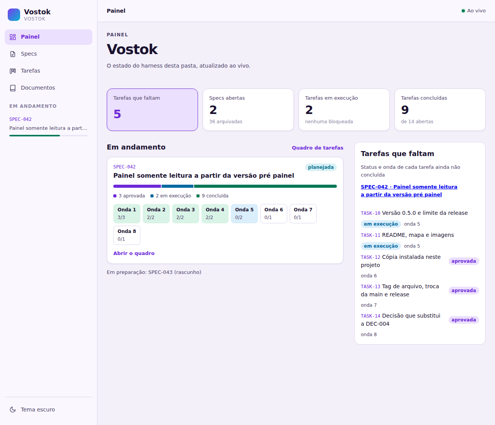
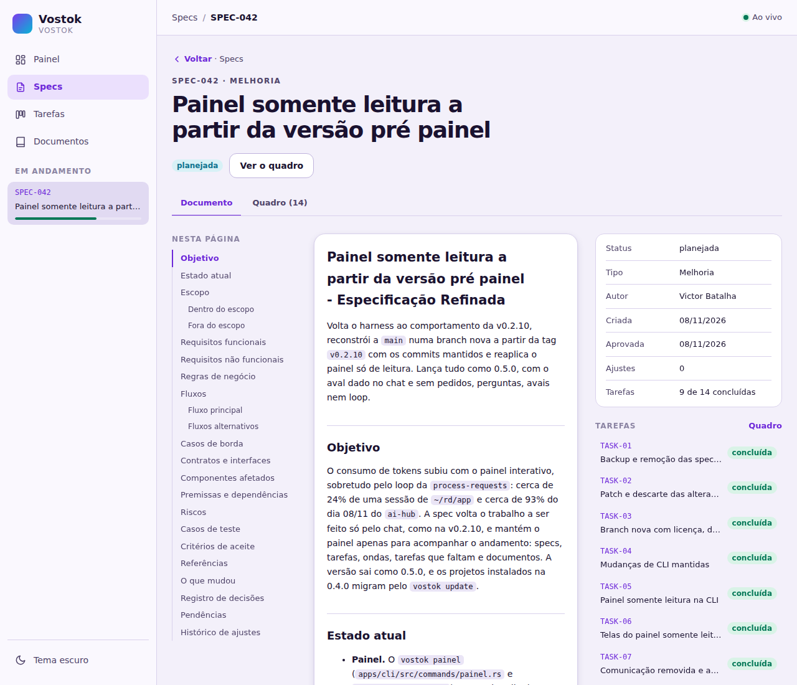
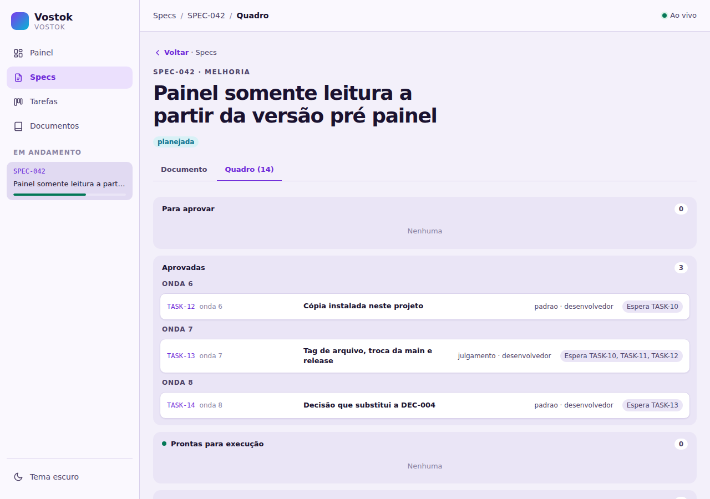
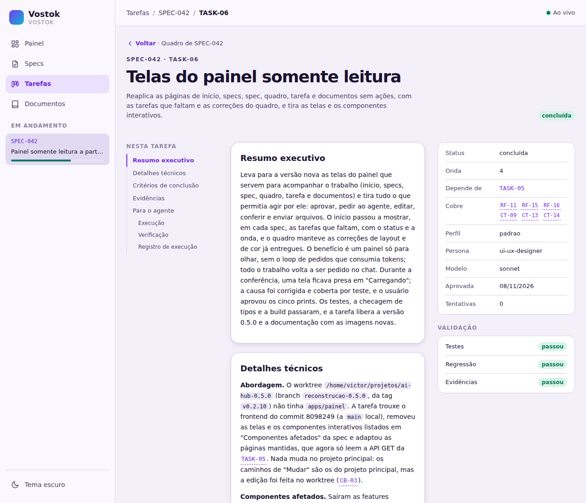
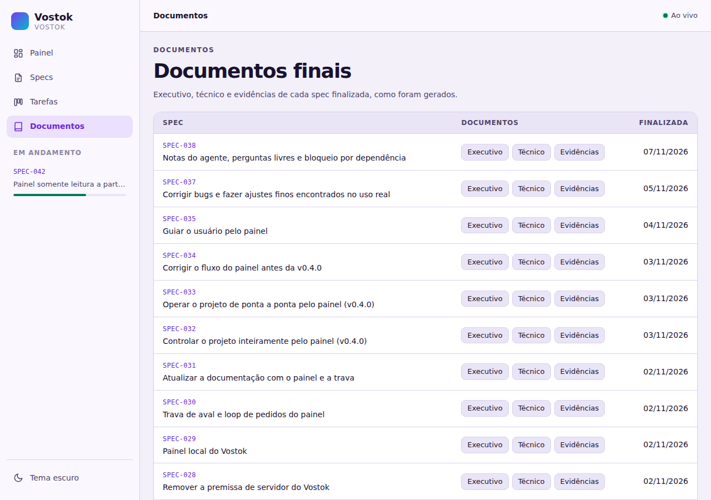

# Vostok

Harness para agentes de IA: regras, skills e memória que levam qualquer ferramenta (Claude Code, Codex, Cursor) pelo mesmo caminho de spec, aprovação, plano e tarefas, com a CLI `vostok` fazendo o trabalho determinístico.

O nome vem da Vostok, a nave do primeiro voo tripulado. Em russo, *vostok* significa "oriente": o harness orienta cada agente.

O Vostok faz parte do ecossistema [Ishtar Sink](https://github.com/Ishtar-Sink).

## Situação

| Fase | O que entrega | Status |
|---|---|---|
| 1. Harness local | Regras, skills e a CLI `vostok`, instalada em qualquer projeto. | Entregue |
| 2. Painel local | Painel somente leitura aberto pelo `vostok painel` em cada pasta, para acompanhar specs, tarefas, ondas e documentos; o trabalho é feito pelo chat. | Entregue na v0.5.0 |

O [mapa do projeto](docs/mapa-vostok.html) mostra, em diagramas interativos, o que já existe e como as partes se conectam.

## Como funciona

- **Harness passivo.** O agente trabalha na ferramenta do desenvolvedor e segue o harness. O harness não depende de nenhuma ferramenta.
- **Determinístico sempre que possível.** O agente escreve o conteúdo; a CLI `vostok` cria arquivos, valida e registra.
- **Configurável.** Caminhos, status, tipos, seções e sequências de IDs ficam em `vostok/config/`.
- **Respostas com template.** Toda resposta do agente segue um dos templates de `templates/responses/`, com estrutura fixa por tipo; as respostas sobre tarefas trazem o quadro do `vostok task status`.
- **Memória.** Decisões (DEC), issues (ISS) e conhecimento (KNW) em Markdown, criadas, buscadas e atualizadas pelo `vostok memory`.
- **Painel local.** O `vostok painel` abre, em cada pasta, um painel no navegador que só lê os arquivos de `vostok/`: specs, tarefas, ondas, as tarefas que faltam e os documentos, atualizados ao vivo. Nada é aprovado, pedido ou executado pelo painel; o trabalho é feito no chat. Veja [Painel local](#painel-local).

### Carregamento de contexto

`CLAUDE.md` aponta para `AGENTS.md`, que manda executar `vostok context load`. As fontes carregadas em toda sessão estão em `vostok/config/context.yml`; cada skill carrega as suas com `vostok context load --skill <nome>`. As regras do harness prevalecem sobre a memória e as instruções próprias da ferramenta.

### Ciclo da spec

```
pedido → draft → refined → approved → plano → tarefas → execução
                    ↑  ↓
                  ajustes
```

| Etapa | Skill | O que faz |
|---|---|---|
| Rascunho | `create-spec` ou `vostok spec new` | Cria a spec em `work/specs/draft/`; a `create-spec` já a preenche a partir da conversa. |
| Refinamento | `refine-spec` | Investiga, pergunta e monta a spec refinada com seções por tipo (feature, improvement, fix, study, analysis). |
| Ajuste | `adjust-spec` | Aplica um ou vários ajustes por mensagem e mantém o histórico. Ajustar uma spec aprovada derruba a aprovação. |
| Aprovação | `approve-spec` | Confere os impedimentos, grava a versão aprovada e remove o rascunho. |
| Plano | `plan-tasks`, `adjust-plan`, `approve-plan` | Quebra a spec aprovada em tarefas, com persona, perfil de execução e onda, e cria um arquivo por tarefa. |
| Tarefas | `approve-task`, `execute-task`, `finish-task` | Aprova, executa (uma tarefa ou uma onda, com subagentes) com baseline e conclui cada tarefa com testes, regressão e evidências. |
| Finalização | `finalize-spec` | Gera os documentos executivo, técnico e de evidências e arquiva a spec. |

Há também a skill `create-skill`, que cria skills no formato padrão e gera os redirecionamentos para cada ferramenta (`.claude/skills/`, `.agents/skills/`).

### Personas e ondas

Cada etapa do ciclo tem uma persona, distribuída em `vostok/personas/` e carregada com `vostok context load --persona <nome>`: Planejador no refinamento e no planejamento; Arquiteto, Engenheiro e QA Lead no detalhamento das tarefas; Desenvolvedor na execução; QA na finalização; UI/UX Designer nas tarefas com interface. Fora das skills, o chat fala como Coordenador, que escolhe a skill, orquestra as ondas e consolida as respostas, sem implementar nem testar.

O `vostok` calcula a onda de cada tarefa pelas dependências: as tarefas de uma onda podem rodar em paralelo. Pedida a execução de uma onda, o Coordenador dispara um subagente por tarefa, com a persona e o modelo dela, e executa em sequência as que mexem no mesmo arquivo, avisando o usuário. A execução de uma tarefa por vez continua disponível. Nas ferramentas que o [estudo de multiagentes](docs/estudos/multiagentes.md) aponta como compatíveis, o `vostok init` e o `vostok update` geram as definições de subagente das personas.

### Perfis de execução

No lugar do nível de esforço, cada tarefa tem um perfil, calculado pelo `vostok plan score` a partir do que a tarefa faz:

| Perfil | O que exige do modelo |
|---|---|
| `mecanica` | Passos diretos e repetitivos; prefere modelo rápido. |
| `padrao` | Implementação com decisões locais; prefere modelo intermediário. |
| `julgamento` | Desenho, ambiguidade e decisões amplas; prefere o modelo mais capaz. |

O Coordenador escolhe, entre os modelos que a ferramenta oferece, o que atende à descrição do perfil; quando a ferramenta não deixa listar ou escolher, usa o apelido de reserva de `vostok/config/models.yml` para a ferramenta de `harness.tool`, em `vostok/config/main.yml`. O projeto troca um apelido em `overrides`; sem apelido, vale o modelo da sessão. O usuário nunca precisa citar o modelo, e o modelo usado fica no registro de execução da tarefa. Planos e tarefas com os níveis antigos continuam válidos: `simples` vale como `mecanica`, `moderada` como `padrao`, `complexa` e `critica` como `julgamento`.

O `vostok task status <SPEC_ID>` mostra as tarefas (persona, perfil, modelo, onda e status) e as ondas, e aparece em toda resposta sobre tarefas.

### Evidências no projeto

As saídas de cada tarefa (baseline, testes, regressão e evidências) ficam em `vostok/work/`, na máquina de quem executou. Para que o time, revisores e auditoria possam conferir a prova, ligue a persistência em `vostok/config/tasks.yml`:

```yaml
persist_dir: docs/evidencias/<SPEC>/<TASK>
persist_readme: README.md
persist_max_mb: 10
```

Na conclusão, a `finish-task` roda `vostok task persist`, que copia os arquivos para essa pasta e gera um guia por tarefa: o que cada evidência prova, o comando que a gera, o trecho que comprova e o que indicaria falha. Caminhos pessoais viram `~`; segredos, IPs, e-mails e CPFs bloqueiam a cópia até o usuário decidir, arquivo por arquivo, entre redigir, excluir ou aceitar. Imagens são revisadas pelo agente, e vídeos e outros binários, pelo usuário. Com a persistência ligada, o `vostok task finish` só conclui a tarefa com o guia completo. O mesmo comando persiste tarefas já concluídas.

### O que o `vostok update` preserva

O `update` regrava só os arquivos que vêm do binário (skills padrão, templates, regras do agente), guardando uma cópia `.local` dos que foram alterados no projeto. As pastas `config/`, `rules/project/`, `skills/custom/` e `memory/` são do projeto e nunca são regravadas; nas configurações, inclusive no `context.yml`, só entram as chaves novas. Regras próprias do projeto e ajustes no mapa de contexto sobrevivem à atualização.

### Defeitos e sugestões do harness

Um defeito do próprio harness (CLI, skills, regras, templates ou configuração distribuídos) encontrado num projeto, ou uma ideia de melhoria ou de recurso, volta para cá por issue:

```
projeto do usuário                                   este repositório                       projeto do usuário
report-harness-bug          → [harness-bug]          ┐
suggest-harness-improvement → [harness-improvement]  ├→ triage-harness-issue → spec → release → resposta → validate-harness-bug
suggest-harness-feature     → [harness-feature]      ┘
```

| Etapa | Onde roda | Skill | O que faz |
|---|---|---|---|
| Relato | Projeto do usuário | `report-harness-bug` | Monta o relato com dados do projeto neutralizados, valida com `vostok bug check` e, com autorização, abre a issue `[harness-bug]` no repositório de `harness.repository` (sem `gh`, pelo link do `vostok bug link`). |
| Sugestão | Projeto do usuário | `suggest-harness-improvement`, `suggest-harness-feature` | Monta a sugestão de melhoria ou de recurso em `work/suggestions/`, neutralizada, valida com `vostok suggest check` e, com autorização, abre a issue `[harness-improvement]` ou `[harness-feature]` (sem `gh`, pelo link do `vostok suggest link`). |
| Triagem | Este repositório | `triage-harness-issue` | Lê a issue, cria a spec do tipo `fix`, `improvement` ou `feature` citando-a e segue o ciclo normal, com o mínimo de tarefas só nos defeitos. Depois da release, comenta na issue, com autorização, a versão e os passos. |
| Validação | Projeto do usuário | `validate-harness-bug` | Encontra a resposta da correção, aplica os passos, confere se o defeito sumiu e, com autorização, comenta o resultado e fecha a issue. |

A `triage-harness-issue` é uma skill customizada deste repositório e não é distribuída; as demais chegam aos projetos pelo `vostok update`. Nenhuma delas escreve no GitHub sem a autorização do usuário depois de ver o texto, e toda pergunta delas usa o template `question`, com a opção recomendada em primeiro.

## Painel local

```bash
vostok painel
```

Dentro de um projeto com o harness, o comando abre no navegador um painel local, só em `127.0.0.1`, que lê os arquivos de `vostok/` e nunca grava neles nem executa comandos: qualquer método que não seja GET recebe 405. Não há servidor remoto nem banco: os arquivos são o banco, e o painel se atualiza sozinho quando o agente muda algo em `vostok/work/`. Use `--porta` para escolher a porta e `--sem-navegador` para só imprimir o endereço.



| | |
|---|---|
|  |  |
| **Spec.** O documento refinado, com as referências e o histórico de ajustes. | **Quadro.** As tarefas da spec por status, com a onda e o perfil de cada uma, e as concluídas recolhidas. |
|  |  |
| **Tarefa.** Execução, verificação, critérios, evidências e registro. | **Documentos.** O executivo e o técnico de cada spec finalizada. |

### Aprovações pelo chat

O aval é o pedido explícito do usuário no chat: aprovar uma spec, um plano ou uma tarefa, finalizar uma tarefa ou uma spec e fazer um commit só acontecem quando o usuário pede ao agente, que roda a skill correspondente. Não há arquivo de aval nem trava; o painel só mostra o resultado.

## Estrutura

```
apps/
  cli/          CLI `vostok` em Rust, com o harness embutido
  painel/       frontend do painel local (Preact), embutido no binário
packages/
  harness/      fonte do harness distribuído (config, context, personas, rules, skills, templates)
vostok/         harness instalado neste projeto pelo `vostok init`
  config/       tudo o que é configurável
  context/      catálogo de skills e contexto do projeto, carregados em toda sessão
  memory/       decisões, issues e conhecimento
  personas/     personas do time: Coordenador, Planejador, Arquiteto, Engenheiro, Desenvolvedor, QA Lead, UI/UX Designer e QA
  rules/        regras do agente e do projeto
  skills/       skills padrão (default/) e do usuário (custom/)
  templates/    respostas, specs, skills e memória
  work/         specs, planos e tarefas
docs/           mapa do projeto, estudos, imagens do painel, débitos e documentos das specs finalizadas
```

## Instalação

Pelo binário da [página de releases](https://github.com/Ishtar-Sink/Vostok/releases), com o painel embutido. Cada versão tem um `vostok-<versão>-<plataforma>.tar.gz` e o `.sha256` dele para `x86_64-unknown-linux-gnu`, `aarch64-unknown-linux-gnu`, `x86_64-apple-darwin` e `aarch64-apple-darwin`. No Linux x86_64:

```bash
curl -fsSLO https://github.com/Ishtar-Sink/Vostok/releases/download/v0.5.0/vostok-0.5.0-x86_64-unknown-linux-gnu.tar.gz
```

```bash
curl -fsSLO https://github.com/Ishtar-Sink/Vostok/releases/download/v0.5.0/vostok-0.5.0-x86_64-unknown-linux-gnu.tar.gz.sha256
```

```bash
sha256sum -c vostok-0.5.0-x86_64-unknown-linux-gnu.tar.gz.sha256
```

```bash
tar xzf vostok-0.5.0-x86_64-unknown-linux-gnu.tar.gz && install vostok ~/.local/bin/
```

No macOS, troque a plataforma e use `shasum -a 256 -c` na conferência. Confira com `vostok --version`.

Também dá para compilar a partir do código, com Rust estável, Node e pnpm (o build gera o painel):

```bash
cargo install --path apps/cli --features painel
```

Sem Node, o `cargo install --path apps/cli` compila a CLI sem o painel, e o `vostok painel` explica como obtê-lo.

Depois, na raiz do projeto:

```bash
vostok init
```

O `init` instala o harness em `vostok/`, pergunta onde ficam os documentos e quais ferramentas você usa (Claude Code, Codex, Cursor) e gera o roteamento só para elas. Use `vostok init --yes --tools claude-code,codex` para não responder às perguntas. Para trazer uma versão nova do harness sem perder o que é do projeto, use `vostok update`.

Requer git, para detectar as seções alteradas em edições manuais e verificar commits.

### Atualizar da 0.4.0

A partir da 0.5.0, a `main` de `Ishtar-Sink/Vostok` foi reconstruída a partir da `v0.2.10`, com o histórico reescrito. O histórico anterior fica na tag `arquivo/main-0.4.0`; as tags `v0.3.0` e `v0.4.0` e a release `v0.3.0` continuam. Quem já tem um clone atualiza com `git fetch origin` e `git checkout -B main origin/main`, depois de guardar o que for seu.

O `vostok update` da 0.5.0 remove as skills `process-requests` e `ask-agent`, os redirecionamentos delas, as chaves da comunicação das configurações e as pastas `vostok/work/pedidos/`, `vostok/work/perguntas/` e `vostok/work/avais/` (ou as configuradas no projeto), listando cada remoção. Antes de rodá-lo, copie essas três pastas para fora do projeto se quiser guardar os pedidos, as perguntas e os avais, por exemplo com `tar czf ~/vostok-comunicacao.tar.gz vostok/work/pedidos vostok/work/perguntas vostok/work/avais`.

## Testes

```bash
cargo test --manifest-path apps/cli/Cargo.toml
```

Os testes de equivalência reproduzem as saídas gravadas dos antigos scripts bash (`apps/cli/tests/fixtures/`). Os cenários com agente estão descritos em [agent-scenarios.md](apps/cli/tests/agent-scenarios.md).

## Idioma

Documentação em português do Brasil; código em inglês.
