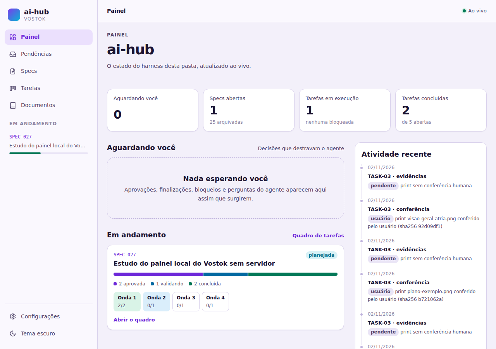
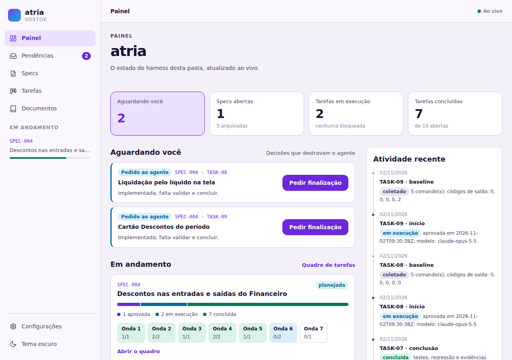
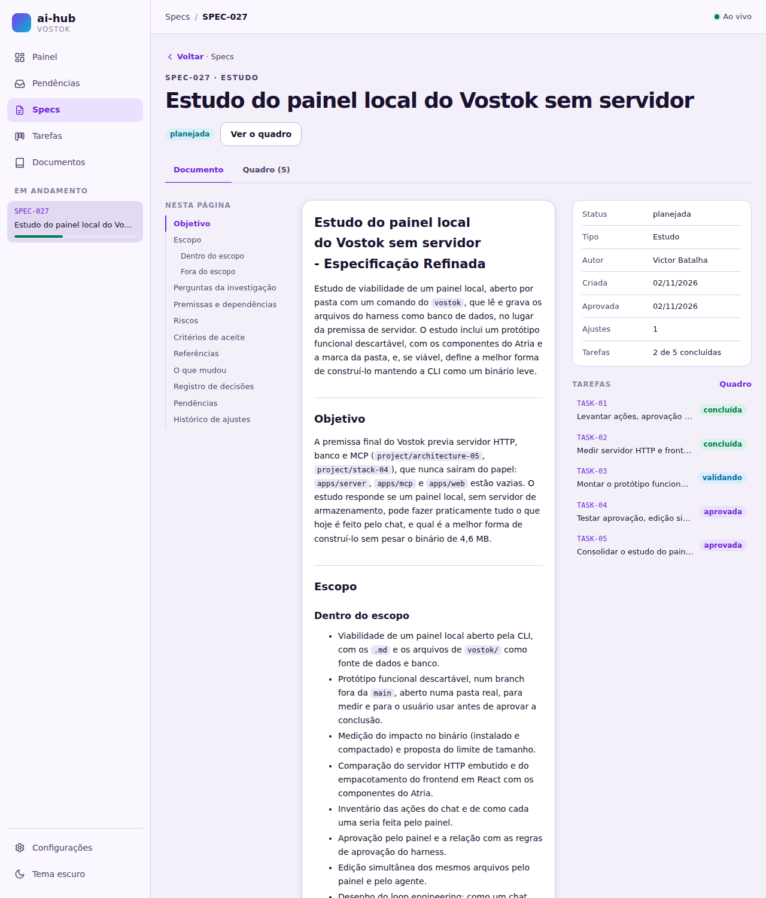
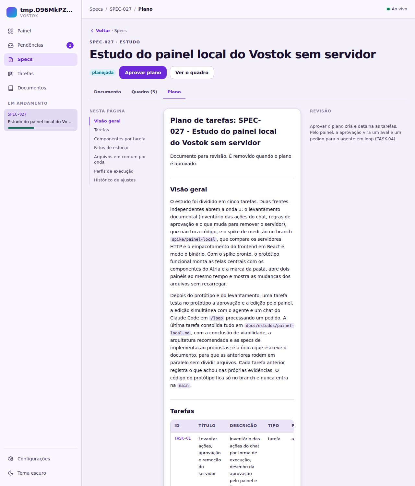
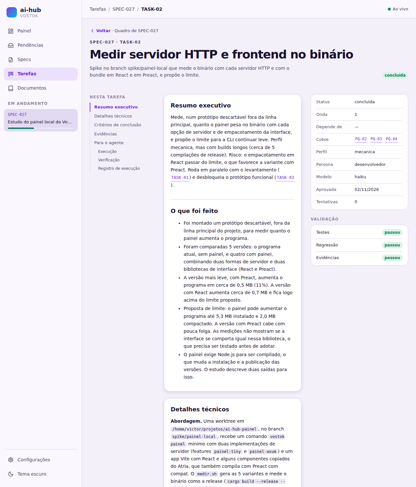

# Estudo do painel local

Data do estudo: 2026-11-02. Versão: `vostok` 0.2.10. Subsídio da SPEC-027.

## Escopo e método

O estudo responde se um painel local pode substituir a premissa de servidor do Vostok. O painel é aberto por pasta com um comando do `vostok` e usa os arquivos de `vostok/` como fonte de dados e os `.md` como banco. A pergunta é se ele faz praticamente tudo o que hoje é feito pelo chat, mantendo a CLI como um binário leve.

As 12 perguntas da spec (PQ-01 a PQ-12) foram respondidas em quatro etapas. Cada uma tem um documento de apoio:

| Etapa | Documento | Perguntas |
|---|---|---|
| Levantamento das ações, da aprovação e da remoção do servidor (TASK-01) | [levantamento.md](painel-local/levantamento.md) | PQ-05, PQ-06, PQ-11 |
| Medição do servidor HTTP e do frontend no binário (TASK-02) | [medicoes.md](painel-local/medicoes.md) | PQ-02, PQ-03, PQ-04 |
| Protótipo funcional usado pelo usuário (TASK-03) | [prototipo.md](painel-local/prototipo.md) | PQ-01, PQ-09, PQ-10, PQ-12 |
| Testes de aprovação, edição simultânea e loop (TASK-04) | [testes.md](painel-local/testes.md) | PQ-01, PQ-06, PQ-07, PQ-08 |

O protótipo fica no branch `spike/painel-local`, na worktree `/home/victor/projetos/ai-hub-painel`, e não entra na `main`. Ele roda com o mesmo binário em quatro pastas:
- o ai-hub;
- o Atria;
- uma cópia com plano aberto;
- uma massa de dados fictícia com specs e tarefas em todos os status.

Os testes de gravação foram feitos numa cópia descartável do projeto, com git próprio, apagada no fim. O usuário usou o protótipo em sete rodadas de ajuste antes de aprová-lo.

## Conclusão

O painel local sem servidor é viável. O protótipo leu specs, planos, tarefas, evidências, documentos e configurações direto dos arquivos de `vostok/`. Ele gravou aprovações, edições e pedidos que passam nos comandos de validação do `vostok` 0.2.10, sem nenhum armazenamento além da própria pasta. Como as gravações chamam as mesmas funções da CLI, o painel não reimplementa regra de negócio: o `vostok` continua sendo quem valida e quem grava o registro.

Os três riscos altos da spec têm resposta medida:
- **Aprovação:** a do painel é feita no mesmo processo, marcada com `approved_by: painel` e acompanhada de um aval num registro só de acréscimo. Um token de sessão impede que um `curl` do agente aprove pelo painel.
- **Edição simultânea:** é resolvida com controle otimista por hash, sem perda de dados e sem trava de arquivo.
- **Escrita de texto:** o que precisa do agente vira um pedido em arquivo, que um chat do Claude Code em `/loop 1m` processou em 1 min 18 s, sem mudança nas skills.

O custo é aceitável, mas maior do que o previsto:
- O painel completo soma 897 KB ao binário (+19,6%, para 5,48 MB) e 286 KB ao tar.gz (2,07 MB). O limite de 5,3 MB proposto na TASK-02, medido com um app mínimo, foi revisto para 6,0 MB, como mostra [Medições](#medições).
- O build da release passa a precisar de Node para gerar o bundle.
- A regra `stack-02` (React) muda para Preact com compat.

## Respostas

### PQ-01

**É viável um painel local que use os arquivos de `vostok/` como fonte de dados e os `.md` como banco, sem servidor de armazenamento?**

Sim. Fontes: [prototipo.md](painel-local/prototipo.md) e [testes.md](painel-local/testes.md).

- **Leitura:** o protótipo abriu o ai-hub e mostrou a visão geral, as pendências, as specs, o quadro de cada spec, o plano, as tarefas com evidências e prints, os documentos arquivados e as configurações. Tudo foi lido dos arquivos da pasta a cada requisição, sem cache nem banco.
- **Gravação:**
  - uma aprovação de tarefa e uma edição de critérios feitas pela interface passaram no `adjust validate` do spike e da 0.2.10;
  - a edição foi registrada pelo `adjust record-manual`;
  - os pedidos foram gravados como `PED-NNN.md`.
- **Limite do protótipo:** a tela de configurações mostra todas as opções com controles próprios, mas o botão "Salvar" ficou desligado. Gravar a configuração fica para a implementação, pelo mesmo caminho da edição.

### PQ-02

**Qual servidor HTTP embutido no `vostok` pesa menos e atende o painel?**

O `tiny_http`. Fonte: [medicoes.md](painel-local/medicoes.md).

- Ele soma cerca de 485 KB ao binário.
- O `axum` com `tokio` soma cerca de 1,02 MB, quase 570 KB a mais com o mesmo bundle.
- O painel não precisa de código assíncrono: são poucas conexões locais, e uma thread por aba aberta basta. O protótipo inteiro roda com 6 threads mais 1 por aba e 5 MB de memória.
- **Ressalva:** o `tiny_http` não envia Server-Sent Events. A resposta só saía no fim da conexão, o que levou a trocar SSE por WebSocket (PQ-12).

### PQ-03

**Como embutir no binário o frontend em React com os componentes do Atria, e com que peso?**

Com Preact com compat no lugar do React, gerado pelo Vite e embutido com `include_dir`, como o harness já é. Fontes: [medicoes.md](painel-local/medicoes.md) e [prototipo.md](painel-local/prototipo.md).

- **Peso:** no app mínimo da TASK-02, o bundle React pesou 230 KB e o Preact 30 KB. No protótipo completo, com os componentes do Atria copiados (botões, diálogos, tabelas, campos de seleção, de cor e de etiquetas), o bundle Preact pesa 158 640 bytes, ou 50 869 com gzip.
- **Compatibilidade:** os componentes do Atria rodaram sem mudança sobre o `preact/compat`.
- **Node no build:**
  - `cargo install --path apps/cli` sem a feature do painel não muda;
  - com a feature, o `include_dir!` exige `apps/painel/dist/` pronto, então a release precisa de um passo de Node e pnpm antes do `cargo build`.
- **Recomendação:** gerar o bundle na CI, com a feature `painel` ligada na release. Uma instalação local sem `dist/` compila sem o painel, e `vostok painel` explica como obtê-lo.
- **Alternativa descartada:** versionar o `dist/`, que deixaria arquivos gerados no git e o risco de um bundle velho no binário.

### PQ-04

**Qual limite de tamanho mantém o binário leve?**

No máximo 6,0 MB (6 000 000 bytes) instalado e 2,3 MB (2 300 000 bytes) no tar.gz da release, revisando os 5,3 MB e 2,0 MB propostos em [medicoes.md](painel-local/medicoes.md).

- **Por que revisar:** o limite anterior foi calculado com um app mínimo (bundle de 30 KB). O protótipo completo mede 5 483 984 bytes e 2 068 511 compactados e já o ultrapassa.
- **Folga:** o novo limite deixa cerca de 516 KB no binário e 231 KB no tar.gz para o que a implementação acrescenta: a trava de aval, a gravação das configurações e os pedidos.
- **O que ele recusa:** as variantes com `axum`, que somam cerca de 540 KB ao `tiny_http`, e o React, que soma cerca de 200 KB ao Preact.
- **Como medir:** o tamanho é conferido na CI da release, com o comando de [Medições](#medições).
- **Ganho possível:** embutir o bundle já compactado com gzip, servido com `Content-Encoding: gzip`, tira cerca de 108 KB do binário.

### PQ-05

**Quais ações do chat o painel consegue fazer, e de que forma?**

Fonte: [levantamento.md](painel-local/levantamento.md), seção "Inventário das ações", com 35 linhas.

| Forma | Linhas | O que entra |
|---|---:|---|
| CLI: o painel chama a lógica do `vostok` | 14 | 5 skills (`approve-spec`, `approve-task`, `approve-commit`, `create-spec` por formulário, `customize-documents`) e 9 comandos de leitura e conferência (status, tarefa, critérios, verificação, commits, memória, regras, migração, `update`) |
| Pedido ao agente: o painel grava `PED-NNN.md` | 17 | 16 skills que escrevem texto, código ou decidem (refinar, planejar, aprovar plano, ajustar, executar, finalizar, relatos do harness) e o commit liberado |
| Fora do painel | 4 | `init-harness`, `init`, `context load` e os comandos internos das skills |

Todo o lado de leitura é feito pela CLI. A edição feita à mão no editor do painel, seguida do `adjust record-manual`, também é CLI, e o protótipo a implementou para tarefa, plano e spec refinada. As ações que escrevem texto continuam com o agente, o que torna o formato de pedido (PQ-08) parte obrigatória do painel.

### PQ-06

**Como uma aprovação feita no painel passa a valer como aprovação do usuário, sem enfraquecer as regras do harness?**

Pelo painel chamando, no mesmo processo, as funções de aprovação que a CLI já usa, com a origem e o aval gravados. Fontes: [levantamento.md](painel-local/levantamento.md), seção "Aprovação pelo painel", e [testes.md](painel-local/testes.md), seção "Aprovação pelo painel".

- **Origem:** é um tipo (`Origin::Chat` ou `Origin::Panel`), nunca um argumento de linha de comando. A CLI grava `approved_by: chat` e o painel grava `approved_by: painel`.
- **Aval:** cada aprovação pelo painel acrescenta uma linha a `vostok/work/avais.log` com a data, o ID, o hash aprovado e a origem.
- **Token:** o painel só aceita ações com o token de sessão que entrega ao navegador. Sem ele, responde 403.
- **Resultado do teste:** a TASK-05 da cópia ficou `approved` com `approved_by: painel`, e as duas versões do `vostok` a validaram.
- **Impacto na suíte da CLI:** 2 testes golden mudam (15 casos de aprovação, só pela linha `approved_by: chat`).

**Alternativa descartada:** um pedido de aprovação processado pelo agente. Ela coloca o agente entre o clique e a aprovação, que é o buraco que a trava de aval quer fechar.

**O que fica para a spec da trava de aval** (memória `spec-trava-aval`):
- a CLI conferir o aval antes de `task finish`, `commit commit`, `commit approve`, `plan approve mark-planned` e `finalize archive`;
- as regras `boundaries-01` e `-04` e as regras de aprovação das skills passarem a aceitar o aval do painel como pedido do usuário.

### PQ-07

**Como evitar perda de dados quando o painel e o agente editam o mesmo arquivo?**

Com controle otimista por hash. Fonte: [testes.md](painel-local/testes.md), seções "Edição pelo painel" e "Edição simultânea".

**Como funciona:**
- **Leitura:** o painel lê o arquivo com `GET /api/fonte`, que devolve o conteúdo e o SHA-256.
- **Gravação:** o painel grava com `PUT /api/arquivo?hash=`, que só grava se o hash for o do disco. Senão, responde 409 com o conteúdo e o hash atuais.
- **Conflito:** o diálogo mostra "Seu texto" e "Versão no disco" lado a lado. Gravar por cima exige um segundo clique explícito.
- **Arquivos protegidos:** `registro.md` e `README.md` das tarefas são recusados (403), porque só o `vostok` os grava.

**Resultado do teste:** com o diálogo aberto e outro processo acrescentando uma linha ao mesmo arquivo, o painel recebeu 409. Nada foi gravado por cima, e os dois textos ficaram disponíveis.

**Registro da edição:** depois de gravar, o painel chama o `adjust record-manual` e mostra na hora os problemas que o `adjust validate` acusa. Uma edição fora do formato derruba a aprovação e impede a execução até ser corrigida.

**Alternativa descartada:** trava de arquivo. Ela ficaria presa se o painel fechasse no meio da edição, e o agente não a respeitaria de qualquer forma.

### PQ-08

**Como um chat em loop (Claude Code ou Codex) percebe e processa os pedidos do painel?**

Por pedidos em arquivo e um chat que confere a pasta periodicamente. Fonte: [testes.md](painel-local/testes.md), seção "Pedido ao agente e loop".

**Formato do pedido:**
- um arquivo `vostok/work/pedidos/PED-NNN.md` por pedido;
- front-matter com `id`, `acao`, `spec`, `tarefa`, `estado` (`pendente`, `em_andamento`, `feito` ou `recusado`), `origem`, `criado_em` e `atualizado_em`;
- seções `## Pedido`, com o texto do usuário, e `## Resultado`, escrita pelo agente.

As ações aceitas são 10. Aprovar tarefa e aprovar spec não são pedidos: o painel aprova direto.

**Perguntas do agente:** usam o mesmo desenho, em `vostok/work/perguntas/P-NNN.md`. A resposta vai como pedido `responder-pergunta`.

**Teste com o Claude Code:** o usuário abriu um chat com `/loop 1m` e uma instrução de uma linha, que mapeia cada ação para a skill correspondente.

| Pedido | Resultado | Tempo |
|---|---|---|
| PED-001 | Recusado com o motivo (a tarefa não passava no `adjust validate`) | 1 min 30 s |
| PED-002 | Feito pela `adjust-task`, com o ajuste registrado como do agente | 1 min 18 s |

Quase todo o tempo é espera pelo intervalo do loop. O processamento leva de 15 a 30 s.

**Codex (sem teste):**
- não tem `/loop` dentro da sessão;
- um processo externo, que pode ser o próprio `vostok`, dispara `codex exec` com a mesma instrução quando aparece um pedido pendente;
- o formato do pedido não muda, porque o painel não sabe qual agente processa a pasta.

### PQ-09

**Como abrir vários painéis ao mesmo tempo, um por pasta?**

Com um processo por pasta, escutando só em `127.0.0.1` e numa porta livre escolhida pelo sistema. Fonte: [prototipo.md](painel-local/prototipo.md), seção "Dois painéis ao mesmo tempo".

- **Abertura:** `vostok painel` sobe as pastas a partir da atual, ou de `--pasta`, até achar `vostok/config/main.yml`. Sem `--porta`, o sistema escolhe uma porta livre, e o painel imprime a URL e abre o navegador.
- **Resultado:** quatro painéis rodaram ao mesmo tempo, nas portas 4700 a 4703: ai-hub, Atria, cópia de exemplo e massa de dados. O `ss -ltnp` mostrou os quatro só em `127.0.0.1`, e cada um tinha os dados e a marca da sua pasta.

### PQ-10

**Como aplicar os componentes do Atria com a marca de cada pasta?**

Pelos tokens de cor, que já têm os mesmos nomes nos dois lados. Fonte: [prototipo.md](painel-local/prototipo.md), seção "Marca e componentes".

- **De onde vêm as cores:** o painel lê o grupo `brand` (nome e ícone) e os grupos `light` e `dark` de `vostok/config/documents.yml` por `GET /api/marca` e os aplica como variáveis CSS sobre o `tokens.css` do `@atria/theme`.
- **Por que o mapeamento é direto:** o `vostok documents brand` já grava os tokens com os nomes do Atria (`bg`, `surface`, `primary`, `text`, `success` e os demais). O mapeamento é nome por nome, sem tradução.
- **Conferido em três pastas:**
  - ai-hub, com o roxo do harness;
  - Atria, com a marca do Atria;
  - uma pasta de exemplo, com o verde-azulado `#0f766e` gravado pelo `documents brand`.
- **Componentes:** foram copiados do Atria (`packages/ui`) até virarem uma biblioteca.

### PQ-11

**O que muda nas regras, na memória e nas pastas do projeto para remover a premissa de servidor?**

Só texto e pastas vazias, porque nenhum código depende do servidor. Fonte: [levantamento.md](painel-local/levantamento.md), seção "Remoção do servidor". O resumo está em [Remoção do servidor](#remoção-do-servidor).

### PQ-12

**Como o painel mostra as mudanças que o agente faz nos arquivos sem recarregar a página?**

Com um WebSocket que avisa o navegador e uma consulta periódica da pasta `work/`. Fontes: [prototipo.md](painel-local/prototipo.md), seção "Atualização ao vivo", e [testes.md](painel-local/testes.md), seção "Edição simultânea".

**Como funciona:**
- O servidor confere a cada 500 ms a maior data de modificação de `vostok/work/`.
- Quando ela muda, envia `mudou` pelo WebSocket `/api/ao-vivo`, e cada tela busca os dados de novo, sem piscar.
- O topo mostra "Conectando", "Ao vivo" ou "Reconectando".

**Resultado:** o critério acrescentado por fora apareceu na tela sem recarregar, com atraso médio de 338 ms em 5 rodadas.

**Por que não Server-Sent Events:** não funcionaram com o `tiny_http`, que só envia a resposta no fim da conexão.

**Consulta periódica ou `notify`:**

| Forma | Binário | Processador com 1 aba aberta |
|---|---|---|
| Consulta periódica | sem acréscimo | 1,6% a 1,8% |
| `notify` | +245 KB | quase zero |

O atraso do aviso é quase o mesmo nas duas, porque o laço de 500 ms ainda limita o aviso.

**Recomendação:** consulta periódica agora. O `notify`, com aviso no próprio evento, entra se pastas grandes tornarem a varredura cara.

## Medições

Tamanhos em bytes, de `vostok` em `--release --locked`, com o tar.gz gerado como na release. As cinco primeiras linhas vêm de [medicoes.md](painel-local/medicoes.md), com um app mínimo. As duas últimas vêm de [prototipo.md](painel-local/prototipo.md), com o protótipo completo.

| Variante | Binário | tar.gz | Bundle | Bundle gzip | Diferença no binário |
|---|---:|---:|---:|---:|---:|
| `vostok` 0.2.10 (base, sem painel) | 4 586 856 | 1 782 243 | - | - | - |
| `tiny_http` + React (app mínimo) | 5 302 120 | 2 016 614 | 230 201 | 70 936 | +715 264 (+15,6%) |
| `tiny_http` + Preact (app mínimo) | 5 102 136 | 1 956 582 | 30 209 | 11 033 | +515 280 (+11,2%) |
| `axum` + React (app mínimo) | 5 839 552 | 2 217 820 | 230 201 | 70 936 | +1 252 696 (+27,3%) |
| `axum` + Preact (app mínimo) | 5 639 192 | 2 157 510 | 30 209 | 11 033 | +1 052 336 (+22,9%) |
| `tiny_http` + Preact (protótipo completo) | 5 483 984 | 2 068 511 | 158 640 | 50 869 | +897 128 (+19,6%) |
| `tiny_http` + Preact + `notify` (protótipo completo) | 5 729 000 | 2 149 561 | 158 640 | 50 869 | +1 142 144 (+24,9%) |

Para reproduzir as variantes do app mínimo:

```bash
pnpm --dir /home/victor/projetos/ai-hub-painel/apps/painel install
bash /home/victor/projetos/ai-hub-painel/apps/painel/medir.sh
```

Para reproduzir o protótipo completo:

```bash
cd /home/victor/projetos/ai-hub-painel/apps/painel && PAINEL_PREACT=1 npm run build
cargo build --release --manifest-path /home/victor/projetos/ai-hub-painel/apps/cli/Cargo.toml --features painel-tiny
ls -l /home/victor/projetos/ai-hub-painel/apps/cli/target/release/vostok
```

**Limite proposto:** 6,0 MB instalado e 2,3 MB compactado (PQ-04).
- O limite anterior, de 5,3 MB e 2,0 MB, aceitava só o app mínimo.
- O novo aceita o protótipo completo, com 516 KB de folga, e recusa as variantes com `axum` e com React.

## Protótipo

As imagens são da TASK-03, com a marca de cada pasta, e foram revisadas pelo usuário.



*Visão geral no ai-hub: indicadores, "Aguardando você", specs em andamento com a barra por status e a atividade recente, com a marca roxa do harness.*



*O mesmo binário aberto no Atria, ao mesmo tempo e em outra porta, com a marca do Atria.*



*Spec com o índice à esquerda, os metadados e as tarefas à direita e as ações no topo.*



*Plano aberto numa pasta de exemplo, com o botão de aprovar.*



*Tarefa com o executivo, o técnico, os critérios e as evidências primeiro, e a parte do agente abaixo.*

## Arquitetura recomendada

| Parte | Recomendação | Alternativa descartada e motivo |
|---|---|---|
| Comando | `vostok painel [--porta N] [--pasta DIR] [--sem-navegador]`: acha `vostok/config/main.yml` subindo as pastas, escuta só em `127.0.0.1`, porta livre por padrão, abre o navegador | Porta fixa: impede dois painéis ao mesmo tempo |
| Servidor | `tiny_http` no próprio `vostok`, uma thread por conexão, atrás da feature `painel` | `axum` com `tokio`: soma 540 KB a mais sem benefício para poucas conexões locais |
| Frontend | `apps/painel`: Vite com Preact com compat, TypeScript, organizado por feature, com os componentes do Atria copiados até virarem biblioteca | React: 200 KB a mais. Escrever componentes próprios: perderia a identidade do Atria |
| Empacotamento | Bundle gerado na CI da release e embutido com `include_dir`. Sem `dist/`, o `vostok` compila sem o painel | `dist/` versionado: arquivos gerados no git e risco de um bundle velho |
| Leitura | API JSON só de leitura: `visao`, `specs/<ID>`, `planos/<ID>`, `tarefas/<SPEC>/<TASK>`, `documentos`, `configuracoes`, `marca`, `fonte` e `arquivo`, lida dos arquivos a cada requisição | Cache ou índice próprio: um segundo armazenamento, que a spec exclui |
| Gravação | `PUT /api/arquivo` com hash otimista e `adjust record-manual` em seguida; `registro.md` e `README.md` recusados | Trava de arquivo: fica presa e o agente não a respeita |
| Eventos | WebSocket `/api/ao-vivo` com aviso `mudou`; consulta periódica de `work/` a cada 500 ms | Server-Sent Events: não funcionam com o `tiny_http`. `notify`: 245 KB a mais, fica para pastas grandes |
| Aprovação | `POST /api/aprovacoes` chama as funções da CLI no mesmo processo e grava `approved_by: painel` e o aval em `work/avais.log`. As ações exigem o token de sessão | Pedido de aprovação ao agente: coloca o agente entre o clique e a aprovação |
| Pedidos | `POST /api/pedidos` grava `work/pedidos/PED-NNN.md` com o estado no front-matter. As perguntas do agente ficam em `work/perguntas/P-NNN.md` | Fila em memória: some ao fechar o painel e o agente não a vê |
| Loop | Claude Code: `/loop` com a instrução padrão do harness. Codex: processo externo que dispara `codex exec` quando há pedido pendente | Mudar as skills para o loop: não foi preciso, as skills atuais processaram o pedido |

O fluxo de dados fica assim:

```text
navegador ──HTTP/WebSocket (127.0.0.1, token)──> vostok painel ──funções da CLI──> vostok/ (.md, .yml, avais.log)
                                                                                     ^
chat em /loop (Claude Code) ou codex exec ──skills e comandos vostok──────────────────┘
                                         <── vostok/work/pedidos/PED-NNN.md ──┘
```

## Specs propostas

As specs vão em ordem: cada uma depende só das anteriores.

1. **Remover a premissa de servidor** (`improvement`):
   - aplica as mudanças de [Remoção do servidor](#remoção-do-servidor) nas regras, na memória `vostok-arquitetura`, nas pastas vazias, no `README.md` e no `docs/mapa-vostok.html`;
   - registra a nova premissa como decisão;
   - não depende de código e libera as regras para as specs seguintes.
2. **Trava de aval** (`feature`):
   - o campo `approved_by` e o registro `work/avais.log`;
   - a conferência do aval antes de `task finish`, `commit commit`, `commit approve`, `plan approve mark-planned` e `finalize archive`, quando a trava estiver ligada;
   - a limpeza do `approved_by` quando um ajuste derruba a aprovação;
   - as regras que aceitam o aval do painel como pedido do usuário;
   - a atualização dos 2 testes golden. É a spec já prevista na memória `spec-trava-aval`.
3. **Painel local de leitura** (`feature`):
   - o comando `vostok painel`, o servidor `tiny_http` atrás da feature `painel` e o app `apps/painel` em Preact com os componentes do Atria;
   - a marca da pasta, as telas do protótipo e a atualização ao vivo;
   - o passo de Node na release, a conferência do limite de 6,0 MB e 2,3 MB e a correção do `tests/common/golden.rs:507` com o `tiny_http`.
4. **Ações e edição pelo painel** (`feature`):
   - o token de sessão, a aprovação direta com o aval e a edição com controle por hash e registro do ajuste;
   - a gravação das configurações.
5. **Pedidos ao agente e loop** (`feature`):
   - os pedidos em `work/pedidos/` e as perguntas em `work/perguntas/`;
   - a instrução padrão do loop no harness, com a skill ou o comando que a carrega;
   - o processo externo para o Codex e a exigência do aval nos pedidos de ações travadas.

## Remoção do servidor

Resumo de [levantamento.md](painel-local/levantamento.md), seção "Remoção do servidor". Nenhum código depende da premissa de servidor, porque as pastas dela estão vazias. A remoção é só de texto e de pastas, aplicada pela primeira spec proposta.

| Onde | Mudança recomendada |
|---|---|
| `[project/architecture-01]` | Reescrever: `apps/cli`, o frontend do painel em `apps/painel` e `packages/harness`. Sair `server`, `mcp` e `contracts` |
| `[project/architecture-05]` | Substituir: os arquivos de `vostok/` são a fonte de verdade; o painel grava só pela lógica da CLI |
| `[project/architecture-06]` | Remover: os tipos do painel ficam junto do frontend |
| `[project/architecture-07]` | Ampliar: a CLI também empacota o bundle do painel e o abre por pasta |
| `[project/architecture-02]`, `[project/architecture-04]` | Revisar: o domínio "evento" vira "aval"; "chamadas de API" passa a ser a API local do `vostok` |
| `[project/stack-02]` | Trocar React com Vite por Preact com compat e Vite (PQ-03) |
| `[project/stack-03]`, `[project/stack-04]`, `[project/stack-07]` | Remover: sem backend em Node, sem MongoDB e sem MCP |
| `[project/stack-06]` | Reescrever: frontend do painel em TypeScript |
| Memória `vostok-arquitetura` | Substituir pela nova premissa: painel local, arquivos como banco, pedidos em arquivo e aval do painel |
| `apps/server`, `apps/mcp`, `apps/web`, `packages/contracts` | Remover as pastas vazias. O frontend fica em `apps/painel`, o nome usado no protótipo |
| `README.md` e `docs/mapa-vostok.html` | Reescrever a fase 2 como "Painel local" e tirar servidor, MongoDB e MCP. O mapa é atualizado no arquivo e no artefato |
